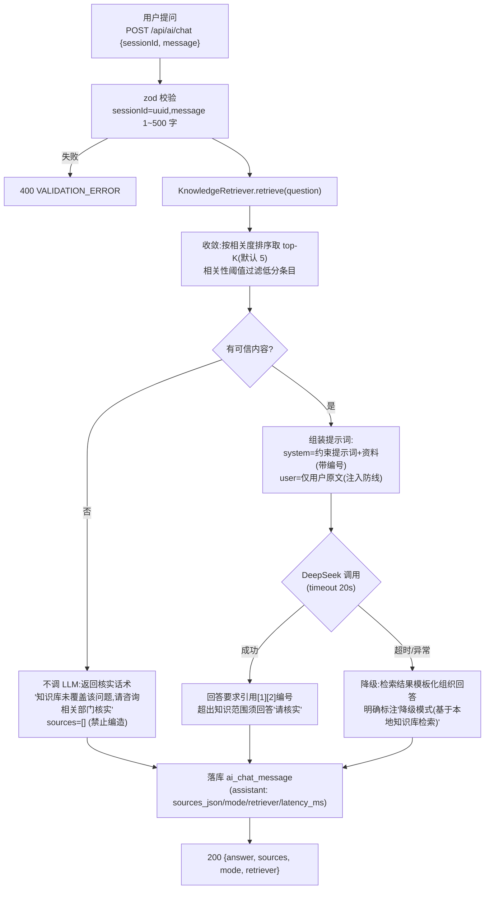

# SSDA AI 组件设计(02-ai-component-design)

> 版本 v1.0(2026-10-24)。对应 FR-13(DeepSeek + 知识库检索收敛,本期必做);接口契约见 `api-contract.md` 2.15 与第 4 节;合规要求见简报 3.5 与 ssda-ai-log skill。当前 DeepSeek Key 暂缺(总控 2026-10-24 记录),开发期按降级模式先行,Key 就绪后仅改 `.env` 启用。

## 1. 总体链路



降级判定优先级:`DEEPSEEK_API_KEY` 未配置 → 直接走模板化回答(mode=fallback,不发起 HTTP);已配置但超时(20s)/网络错误/HTTP 非 2xx/返回空 → 同样降级并记录错误日志;检索无内容 → 无论 LLM 可用与否都返回拒答话术(**禁止编造**)。

## 2. KnowledgeRetriever 接口定义

```ts
// backend/src/ai/retriever/types.ts
export type SourceType = 'knowledge' | 'service' | 'activity' | 'course' | 'teacher' | 'location';

export interface RetrievedSource {
  type: SourceType;
  id: number;
  title: string;
  snippet: string;      // 命中片段或摘要,≤120 字
  source: string;       // 原始来源(知识条目 source 必填;指南取 department 等)
  updatedAt: string;    // 'YYYY-MM-DD HH:mm:ss'
  score: number;        // 相关度得分,用于排序与阈值过滤
}

export interface RetrieverResult {
  items: RetrievedSource[];   // 已收敛的 top-K(默认 K=5)
  isReliable: boolean;        // 是否存在可信内容(score ≥ 阈值且 items 非空)
  retriever: 'local_kb' | 'http_kb';
}

export interface KnowledgeRetriever {
  retrieve(question: string): Promise<RetrieverResult>;
}
```

### 2.1 LocalKbRetriever(默认实现,启用)

- 数据范围:**仅已发布/上架内容**——`knowledge(status='published')`、`service_guide(is_enabled=1)`、`campus_activity(is_enabled=1)`、`course`、`teacher`、`location`;已下架/草稿/待审核一律检索不到。
- 检索方式(Phase 2 实现,体检后 v1.1 修订):对 question 先保整句(2~8 字问句整句为 strongTerm,命中 ×2 加权),≥3 字分段切**步长 1 的重叠 2-gram**(修复步长 2 切分丢失词边界的问题);各表 `title LIKE CONCAT('%', ?, '%')` 优先、`content/描述` 次之(全部参数化);打分 = (标题命中 ×3 + 摘要命中 ×1,整句命中 ×2)×(1 + 查询词覆盖率) + 已核实 ×1 + 在有效期内 ×1;按 score 降序取 top-5;最高分低于阈值(默认 1)时 `isReliable=false`。过期知识可被检索但在 `snippet` 中带"(已过期)"标注。覆盖率权重用于抑制高频 2-gram 的排序噪声,保证命中查询中不同关键词的条目优先。
- 每条结果标注来源字段(`source/department` 等)与 `updatedAt`,供前端展示与 `sources_json` 落库。
- 说明:关键词匹配属初版实现;升级为全文索引属契约外内部优化,不影响接口。

### 2.2 HttpKbRetriever(预留实现,默认不启用)

- 通过环境变量 `KB_API_BASE_URL` 配置外部知识库地址;**未配置时容器/服务内不注册该实现**,`retriever` 取 `local_kb`。
- 适配行为:POST `{baseUrl}/retrieve` body `{ question, topK }`,期望响应 `{ items: [{ title, snippet, source, updatedAt }] }`;超时 5s,失败时抛错由 service 层按"检索无结果"处理并记日志(不影响主流程)。
- 切换方式:实现 `KnowledgeRetriever` 接口 + 工厂按 env 选择,**不改动 service 其余代码**(简报第 2 节"仅改配置")。

## 3. 提示词设计

### 3.1 system prompt 全文(v1,存档路径 `docs/ai-logs/prompts/ai-chat-system-prompt-v1.md`,启用前由 AI 模块 Agent 落档)

```text
你是"新生校园知识库助手",服务对象是大学新生。请严格遵守以下规则:
1. 只依据"资料"部分提供的内容回答;资料之外的信息一律不得编造或推断。
2. 回答末尾列出引用来源编号,格式如:
   来源:
   [1] 条目标题(来源:xxx,更新于 YYYY-MM-DD)
   仅引用实际使用的条目。
3. 如果资料不足以回答用户问题,或资料之间互相矛盾,回答:"知识库未覆盖该问题,请咨询相关部门核实",不要给出未经验证的细节。
4. 涉及有效期、费用、办理时间等易变信息,提醒用户以最新通知为准。
5. 不收集、不询问、不记录用户的姓名、学号、身份证号等个人身份信息。
6. 不回答与校园生活、办事、教学无关的问题,礼貌说明职责范围。
7. 使用简体中文,语气友好,回答不超过 300 字,步骤类问题用编号列表。

以下是检索到的资料(每条以 [编号] 开头):
{sources_block}
```

- `{sources_block}` 由服务端从 `RetrieverResult.items` 渲染:`[1] 标题 | 类型 | 摘要 | 来源 | 更新时间`,**仅来自已发布数据**,不含任何用户历史消息。
- **提示词注入防线**:用户输入只进 user message,禁止拼入 system prompt(简报第 7 节、ssda-code-audit 高风险项);user message 原文透传,不做模板包裹,同时长度 500 上限在 zod 层截断请求。
- user message:即 `message` 字段原文。

### 3.2 生成参数与输出约束

| 参数 | 值 | 说明 |
|---|---|---|
| model | `deepseek-chat` | OpenAI 兼容协议 |
| temperature | 0.3 | 偏保守,减少编造倾向 |
| max_tokens | 600 | 覆盖 300 字回答 + 来源列表 |
| timeout | 20s | 超时即降级 |
| stream | false | 本期一次性返回,便于落库与耗时统计 |

## 4. DeepSeek 适配器

```ts
// backend/src/ai/llm/deepseek-adapter.ts(签名示意)
export interface LlmResult {
  answer: string;
  latencyMs: number;
}

export interface LlmAdapter {
  chatCompletion(system: string, user: string): Promise<LlmResult>; // 失败抛 LlmError
}

export class DeepSeekAdapter implements LlmAdapter {
  // POST {DEEPSEEK_BASE_URL|https://api.deepseek.com}/chat/completions
  // headers: Authorization: Bearer ${DEEPSEEK_API_KEY}
  // body: { model: 'deepseek-chat', temperature: 0.3, max_tokens: 600,
  //         messages: [{ role: 'system', content: system }, { role: 'user', content: user }] }
  // AbortController 20s 超时;非 2xx / 无 choices → LlmError
}
```

- 可替换性:实现同一 `LlmAdapter` 接口即可切智谱/通义(简报第 2 节);工厂按 `LLM_PROVIDER` env 选择,默认 `deepseek`。
- `DEEPSEEK_API_KEY` 只放 `backend/.env`(不入 git、不出现在日志/提示词存档/导出文件);未配置时工厂返回 `NullLlmAdapter`(调用即抛 `LlmUnavailable`),service 捕获后走降级。
- 降级回答模板(fallback):`根据本地知识库检索结果(降级模式,仅供参考):\n1. <title> — <snippet>…\n来源:[1] …`,并固定首行注明"当前为降级模式,回答由本地检索结果直接整理,请以官方通知为准"。

## 5. 合规四性对照(课程硬性要求)

| 要求 | 设计落地 | 证据/验证 |
|---|---|---|
| 可解释 | 回答附来源编号列表;`sources[]` 随响应返回并渲染可点击来源;`mode/retriever` 如实标注生成方式;管理员可在 /admin/ai-logs 逐条审计 | 契约 2.15;ai_chat_message.sources_json;AI 专项用例 |
| 鲁棒 | 三级兜底:检索无内容→拒答话术;LLM 超时 20s/异常/未配 Key→降级模板;输入长度 1~500 由 zod 拦截;外部检索失败不影响主流程;`mode=fallback` 留痕可统计降级率 | ai_chat_message.mode;导出 JSONL 统计 |
| 公平 | 无用户画像、无个性化排序;所有用户同一检索与提示词;不记录 IP/设备;`sessionId` 仅用于串联会话 | 代码评审(ssda-code-audit)+ 隐私自查 |
| 隐私 | 仅匿名 uuid(sessionId);不收集姓名/学号/联系方式;zod 与提示词双防线阻止索取身份信息;导出文件含对话原文,不入 git、提交前脱敏抽查 | ai_chat_session.session_key 无身份列;.gitignore docs/ai-logs/exports/ |

## 6. 日志设计(ssda-ai-log 轨道①)

### 6.1 表结构(与 01-system-design ER 图一致)

- `ai_chat_session`:`id` PK、`session_key` UNIQUE(uuid,36)、`created_at`。首次对话惰性建会话,无账号关联列。
- `ai_chat_message`:`id` PK、`session_id` FK(ON DELETE CASCADE)、`role`(user/assistant)、`content` TEXT、`sources_json` JSON(assistant 专有,user 为 NULL)、`mode` VARCHAR(10,`deepseek|fallback`,user 为 NULL)、`retriever` VARCHAR(20,`local_kb`,预留 `http_kb`)、`latency_ms` INT(检索+生成总耗时)、`created_at`。
- 索引:`ai_chat_message(session_id, created_at)`、`(created_at)`(管理端按时间筛选)。

### 6.2 管理端查看与导出

- 查看:`GET /api/admin/ai-logs?sessionKey&startDate&endDate&page&pageSize`(契约 3.19)。
- 导出:`npm run export:ai-logs`(backend scripts)与 `GET /api/admin/ai-logs?export=1` 均输出 JSONL,字段统一:
  `{"sessionId":"<uuid>","role":"user|assistant","content":"…","sources":[{"type","id","title"}],"mode":"deepseek|fallback","createdAt":"YYYY-MM-DD HH:mm:ss"}`
- 文件位置:`docs/ai-logs/exports/ai-chat-export-YYYYMMDD-HHmm.jsonl`;**不入 git**(`.gitignore` 已含 `docs/ai-logs/exports/`),阶段提交单独打包;导出脚本结束时输出总条数与 fallback 条数(降级率,鲁棒性证据)。
- 提示词版本链:`docs/ai-logs/prompts/ai-chat-system-prompt-v1.md` 起步,改动语义必须新版本文件 + dev-usage-log 台账登记(禁原地改写)。

### 6.3 落库时机与失败策略

- user 消息在检索前落库(即使后续异常也有输入记录);assistant 消息在组装响应后、返回前落库;落库失败不阻塞响应,记 error 日志(对话可用性优先,日志可由导出兜底补录说明)。
- `latency_ms` = 检索耗时 + LLM 耗时(降级时仅检索耗时),服务于"2 秒口径"观测与降级率分析。
