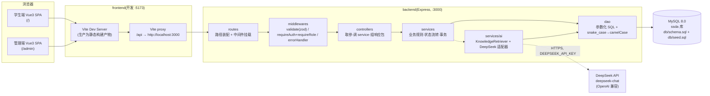
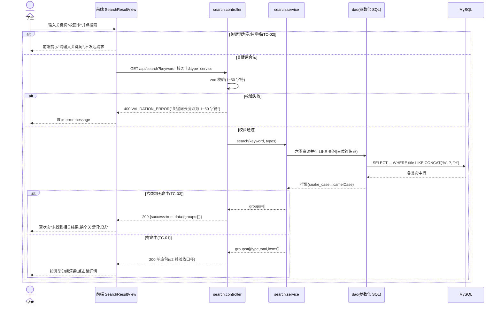
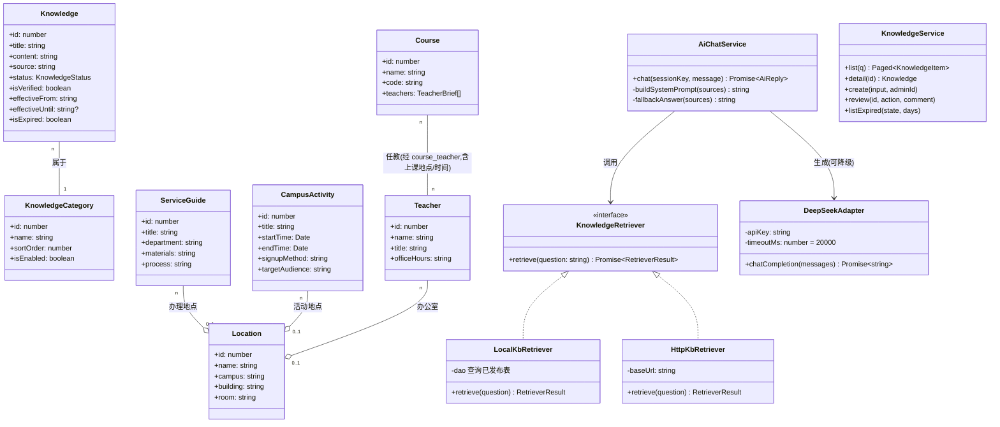

# SSDA 系统设计

> 版本 v1.0(2026-10-24,需求与设计 Agent 产出,随契约一并提交总控评审)。接口路径、字段、状态枚举与 `接口契约.md` v1.0 保持一致;需求编号引用简报第 3 节。

## 1. 系统架构



要点:

- 前端一律写相对路径 `/api/...`,由 Vite proxy 转发,避免跨域与硬编码 host。
- 后端分层严格单向:`routes → controllers → services → dao → MySQL`,禁止跨层(controller 不碰连接池,dao 不判业务权限)。
- `services/ai` 为旁路模块:与普通 service 同级,由 AI 对话控制器进入;LLM 不可用时在 service 内部降级,不影响其余接口。
- 初始化脚本在仓库根 `db/`(`schema.sql` + `seed.sql`,总控已裁决),后端连接配置走 `backend/.env`(不入 git)。

## 2. 分层职责(与 ssda-backend skill 一致)

| 层 | 职责 | 禁止事项 |
|---|---|---|
| routes | 声明"路径 → 中间件 → 控制器"装配;挂 validate/requireAuth/requireRole | 不写业务逻辑 |
| controllers | 解析 query/body(zod 在此触发)、调 service、组装 `{success, data}` 响应包 | 不写 SQL、不碰连接池 |
| services | 业务规则(如"仅 published 且未过期对学生正常展示""发布前必须审核""published/takedown 编辑后回退 draft")、事务边界 | 不 import req/res |
| dao | 仅参数化 SQL 与行↔对象映射(snake_case → camelCase) | 不判断业务权限;禁止拼接用户输入 |
| services/ai | KnowledgeRetriever 检索 + DeepSeek 生成 + 降级编排 | 用户输入不得拼进 system prompt |

## 3. ER 图(11 实体 / 12 张表)

> 命名:数据库列 snake_case;`ai_chat_session + ai_chat_message` 为 AI 日志组,合计 11 个实体。所有表含 `created_at` / `updated_at`(下图省略);主键 `id` 均 BIGINT UNSIGNED AUTO_INCREMENT。

```mermaid
erDiagram
    knowledge_category {
        int id PK "自增主键"
        varchar name UK "分类名,唯一,1~50 字"
        varchar description "分类说明,≤200"
        int sort_order "排序,越小越靠前"
        tinyint is_enabled "1 启用 0 停用(M01)"
    }
    knowledge {
        int id PK
        int category_id FK "→ knowledge_category.id"
        varchar title "1~100 字,必填"
        text content "正文,必填"
        varchar source "来源,必填(FR-11)"
        enum status "draft|pending_review|published|takedown 四态"
        tinyint is_verified "1 已核实 0 待核实(FR-10 提示)"
        date effective_from "有效期起,必填"
        date effective_until "有效期止,可空=长期有效"
    }
    knowledge_change_log {
        int id PK
        int knowledge_id FK "→ knowledge.id,ON DELETE CASCADE"
        int admin_id FK "→ admin_user.id"
        varchar action "create|update|delete|submit_review|review_publish|review_reject|takedown"
        text detail "变更摘要/驳回原因"
    }
    location {
        int id PK
        varchar name "地点名,1~100 字,必填"
        varchar campus "校区,必填"
        varchar building "建筑"
        varchar floor "楼层"
        varchar room "房间"
        varchar description "≤500"
    }
    service_guide {
        int id PK
        varchar title "1~100 字,必填"
        varchar department "办理部门,1~100 字,必填"
        int location_id FK "→ location.id,可空"
        varchar service_time "办理时间,≤100"
        text materials "所需材料"
        text process "办理流程"
        tinyint is_enabled "1 上架 0 下架"
    }
    campus_activity {
        int id PK
        varchar title "1~100 字,必填"
        datetime start_time "开始时间,必填"
        datetime end_time "结束时间,必填且≥start_time"
        int location_id FK "→ location.id,可空"
        varchar signup_method "报名方式,≤200"
        varchar target_audience "适用对象,≤200"
        text description "活动说明"
        tinyint is_enabled "1 上架 0 下架"
    }
    teacher {
        int id PK
        varchar name "姓名,1~50 字,必填"
        varchar title "职称,≤50"
        int office_location_id FK "→ location.id,可空(办公室)"
        varchar office_hours "答疑时间,≤100"
    }
    course {
        int id PK
        varchar name "课程名,1~100 字,必填"
        varchar code UK "课程代码,唯一,1~20"
        varchar semester "学期,如 2026-2027-1"
        varchar description "≤500"
    }
    course_teacher {
        int id PK
        int course_id FK "→ course.id"
        int teacher_id FK "→ teacher.id"
        int location_id FK "→ location.id,可空(上课教室)"
        varchar schedule "上课时间,≤100"
    }
    admin_user {
        int id PK
        varchar username UK "登录名,唯一,3~30"
        varchar password_hash "bcryptjs 哈希,禁明文"
        varchar role "固定 admin(为 requireRole 预留)"
        datetime last_login_at "最近登录"
    }
    ai_chat_session {
        int id PK
        varchar session_key UK "匿名 uuid,36 位,不关联身份"
    }
    ai_chat_message {
        int id PK
        int session_id FK "→ ai_chat_session.id,ON DELETE CASCADE"
        enum role "user|assistant"
        text content "消息正文"
        json sources_json "引用来源数组(JSON),assistant 专有"
        varchar mode "deepseek|fallback,assistant 专有"
        varchar retriever "local_kb(预留 http_kb)"
        int latency_ms "检索+生成总耗时"
    }

    knowledge_category ||--o{ knowledge : "分类下知识"
    knowledge ||--o{ knowledge_change_log : "修改日志(M10)"
    admin_user ||--o{ knowledge_change_log : "操作人"
    location |o--o{ service_guide : "办理地点"
    location |o--o{ campus_activity : "活动地点"
    location |o--o{ teacher : "办公室"
    location |o--o{ course_teacher : "上课教室"
    course ||--o{ course_teacher : "任教关系"
    teacher ||--o{ course_teacher : "任教关系"
    ai_chat_session ||--o{ ai_chat_message : "会话消息"
```



关键业务约束(DDL 落地时在 db/schema.sql 体现):

1. `knowledge.status` 四态 `draft / pending_review / published / takedown`;流转规则见契约 3.4~3.9(**先审后发**:published/takedown 编辑保存自动回退 draft)。
2. `knowledge.source` 必填、`effective_from` 必填;`effective_until` 可空表示长期有效;`CHECK (effective_until IS NULL OR effective_until >= effective_from)`。
3. 学生端可见性:`status='published'` 才出现在列表/详情;其中 `effective_until < 今天` 的仍可见但 `isExpired=true`(前端过期横幅,TC-09);`takedown` 一律 404。
4. `teacher` 仅存允许公开字段(姓名/职称/办公室/答疑时间),**不设**电话、工号等隐私列。
5. 删除保护:分类下有知识 → 409;地点被引用 → 409;课程/教师有任教关系 → 409;知识仅 draft 可物理删除(其余引导下架);`knowledge_change_log.knowledge_id`、`ai_chat_message.session_id` 级联删除。
6. AI 日志隐私红线:`ai_chat_session.session_key` 为匿名 uuid,全链路不出现学号/姓名/IP 等身份信息。

## 4. 核心时序图

### 4.1 P02 学生搜索办事信息(覆盖 TC-01/02/03)



### 4.2 P04 管理员维护并发布知识(覆盖 TC-06/07/08)

```mermaid
sequenceDiagram
    actor A as 管理员
    participant F as 管理端 KnowledgeManageView
    participant C as knowledge.controller
    participant SV as knowledge.service
    participant DB as MySQL

    A->>F: 输入账号密码登录
    F->>C: POST /api/admin/auth/login
    C-->>F: 200 {token}(失败:401"用户名或密码错误")
    F->>F: token 存 localStorage(ssda_token),守卫放行

    A->>F: 填写新知识表单并提交
    F->>C: POST /api/admin/knowledge (Bearer token)
    alt 未带/无效 token 或角色不符(TC-07)
        C-->>F: 401 UNAUTHORIZED / 403 FORBIDDEN
        F-->>A: 清 token 跳 /admin/login 或提示无权限
    else zod 校验失败(TC-08:缺标题/日期非法)
        C-->>F: 400 VALIDATION_ERROR("标题不能为空"/"日期格式应为 YYYY-MM-DD")
        F-->>A: 表单逐字段展示错误,拒绝保存
    else 校验通过(TC-06)
        C->>SV: create(payload, adminId)
        SV->>DB: INSERT knowledge(status=draft);INSERT knowledge_change_log(create)
        DB-->>SV: id
        SV-->>C: {id, status:"draft"}
        C-->>F: 200 响应包
    end

    A->>F: 提交审核 → 审核通过
    F->>C: POST /:id/submit-review
    C->>SV: pending_review + 日志
    F->>C: POST /:id/review {action:"publish"}
    SV->>DB: UPDATE status=published + 日志(review_publish)
    C-->>F: 200 {id, status:"published"}
    Note over SV,DB: 红线:仅 published 且在有效期内,学生端按正常状态可见
    A->>F: 学生端验证
    F->>C: GET /api/knowledge?keyword=宿舍网络
    C-->>F: 新知识出现在学生端列表
```

### 4.3 P05 管理员核实并处理过期信息(覆盖 TC-09)

```mermaid
sequenceDiagram
    actor A as 管理员
    participant F as ExpiredWorkbenchView
    participant C as knowledge.controller
    participant SV as knowledge.service
    participant DB as MySQL
    participant STU as 学生端

    A->>F: 打开过期信息工作台
    F->>C: GET /api/admin/knowledge/expired?days=7 (JWT)
    C->>SV: 列出 expired(effective_until<今天)与 expiring(≤7 天)
    Note over SV: 仅按日期识别,不自动标记"真实有效"(P05 红线,由管理员人工核实)
    SV->>DB: SELECT ... WHERE status='published' AND ...
    DB-->>C: list(state/daysOverdue)
    C-->>F: 200 响应包

    alt 分支一:核实后更新内容
        A->>F: 编辑正文/有效期,保存
        F->>C: PUT /api/admin/knowledge/:id
        SV->>DB: 保存内容;published→draft(重新走审核)+ 日志
        A->>F: 提交审核 → 审核通过(见 P04)
    else 分支二:核实后下架
        A->>F: 点击"下架"
        F->>C: POST /api/admin/knowledge/:id/takedown
        SV->>DB: UPDATE status=takedown + 日志
        C-->>F: 200 {status:"takedown"}
    end

    STU->>C: GET /api/knowledge/:id
    alt 已下架(takedown)
        C-->>STU: 404 NOT_FOUND("知识不存在或未发布")
    else published 且 effective_until<今天
        C-->>STU: 200 {status:"published", isExpired:true, effectiveUntil}
        STU-->>STU: 详情页顶部渲染过期横幅"该信息已过有效期,仅供参考,请核实"(TC-09)
    else published 且在有效期内
        C-->>STU: 200 {isExpired:false},正常展示
    end
```

### 4.4 AI 对话链路(检索 → 生成 → 落库 → 返回来源,含降级)

```mermaid
sequenceDiagram
    actor S as 学生
    participant V as AiChatView
    participant C as ai.controller
    participant SV as aiChat.service
    participant KR as KnowledgeRetriever\n(LocalKbRetriever)
    participant DB as MySQL
    participant LLM as DeepSeek 适配器

    S->>V: 提问"校园卡丢了怎么补办?"
    V->>C: POST /api/ai/chat {sessionId(uuid), message}
    C->>C: zod 校验(400 分支:sessionId 非法/message 空或超 500 字)
    C->>SV: chat(sessionId, message)
    SV->>DB: 写 ai_chat_message(role=user);无会话则先建 ai_chat_session
    SV->>KR: retrieve(message)
    KR->>DB: 已发布知识/指南/活动等表关键词检索(参数化)
    DB-->>KR: 候选条目(含 title/source/updatedAt)
    KR-->>SV: RetrieverResult{items, isReliable}
    alt 无可信内容
        SV-->>C: answer="知识库未覆盖该问题,请咨询相关部门核实",sources=[],mode=实际模式
    else 有可信内容
        SV->>LLM: chatCompletion(system=约束提示词, user=仅用户问题)
        alt LLM 超时(20s)/异常
            Note over SV: 降级:检索结果模板化组织回答,明确标注降级模式
            SV-->>C: answer=模板化回答, sources=条目, mode="fallback"
        else LLM 成功
            LLM-->>SV: 回答(要求引用[1][2]来源编号)
            SV-->>C: answer=回答, sources=条目, mode="deepseek"
        end
    end
    SV->>DB: 写 ai_chat_message(role=assistant, sources_json, mode, retriever, latency_ms)
    C-->>V: 200 响应包
    V-->>S: 渲染回答 + 来源列表;mode=fallback 时展示降级提示条
```

## 5. 类图(核心领域对象与 AI 模块抽象)



## 6. 技术选型与 NFR 落地说明

| 选型(已冻结) | 用途 | NFR 落地点 |
|---|---|---|
| Vue3 + TS + Vite + Element Plus + Pinia | 学生端/管理端 SPA | 组件化复用状态标签、过期横幅;路由守卫仅体验层 |
| Express + TS + zod + mysql2 | 后端 API | zod 统一 400 且 message 带字段名(TC-08) |
| mysql2 参数化查询 + 连接池 | 数据访问 | SQL 全占位符、LIKE 通配符进参数、排序走白名单 → SQL 注入免疫 |
| jsonwebtoken + bcryptjs | JWT 与密码哈希 | 密码不明文;401/403 服务端强制(TC-07);响应不回哈希 |
| DeepSeek(OpenAI 兼容)+ KnowledgeRetriever | AI 问答 | 检索收敛回答范围;超时 20s 降级;来源引用可解释 |
| Jest+Supertest / Vitest | 测试 | TC-01~10 自动化映射(ssda-testing 维护) |

NFR 验收口径落地:

- **性能(普通查询 2 秒内)**:连接池复用;列表查询只取展示列并建索引(`knowledge(category_id,status)`、`knowledge(effective_until)`、各表 title 前缀索引);请求耗时中间件记录 P95;聚合搜索六类并行查询。
- **安全**:参数化 SQL;bcrypt(cost 10);JWT 12h;错误响应不泄露堆栈/SQL/凭据;`.env` 不入 git(密钥清单:`DB_*`、`JWT_SECRET`、`DEEPSEEK_API_KEY`、`KB_API_BASE_URL` 可选)。
- **过期状态展示规则(全端统一口径)**:
  1. `published` 且在有效期内 → 学生端正常展示;
  2. `published` 且过有效期 → 仍可见,详情/列表带过期标识(详情页过期横幅),文案注明"仅供参考,请核实";
  3. `takedown`(及 draft/pending_review)→ 学生端不可见,详情请求返回 404;
  4. `isVerified=0` → 展示"待核实"标签,不自动标记真实有效(P05 红线)。
- **兼容性**:Chrome/Edge 最新两个大版本;代码兼容 Node 22(本地 v24 开发)。
- **可追溯**:管理端写操作一律落 `knowledge_change_log`;来源与 `updatedAt` 全链路返回并展示(FR-11)。
